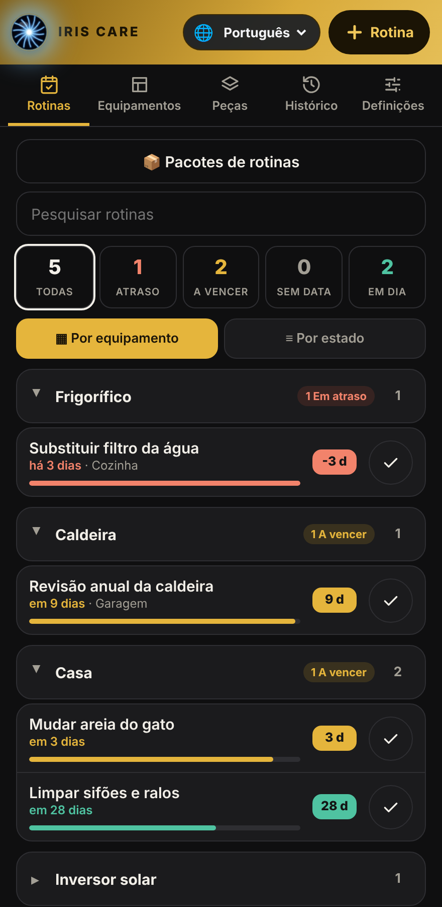
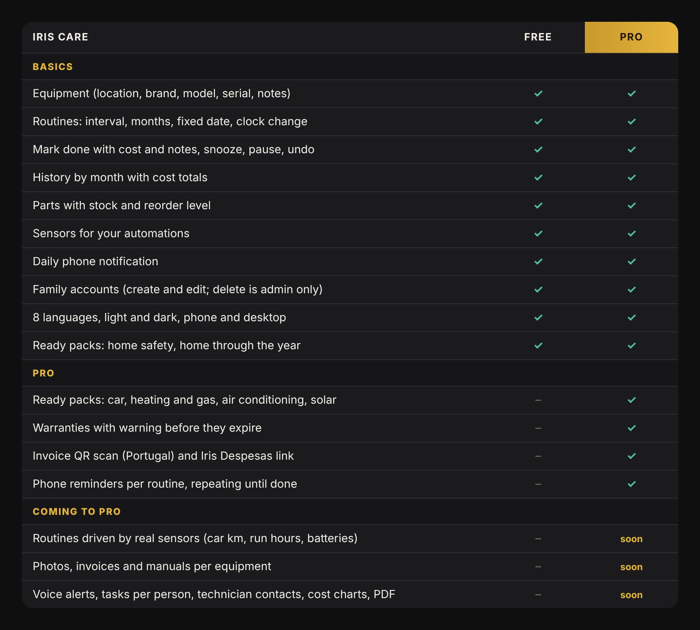
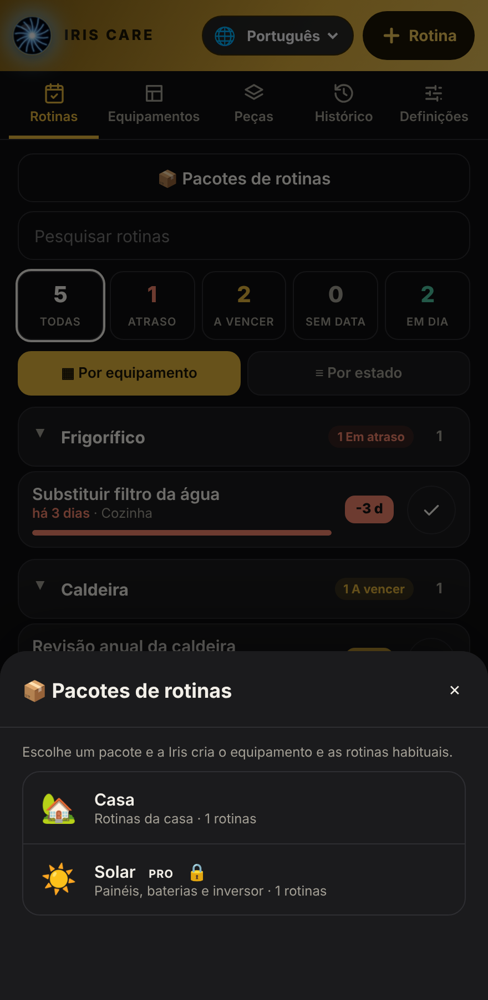

# Iris Care

**Home maintenance manager for Home Assistant.** Equipment, routines, parts, history and a dashboard card that tells you at a glance what is overdue, what is due soon and what is fine.

🇵🇹 [Versão em português](README.pt.md)

<p align="center"></p>

Built by [Eletro Solar Basto](https://github.com/Hollywoodchaos). Iris Care is **Free and open source**; **Iris Care Pro** adds extra packs and features (see [Free vs Pro](#free-vs-pro)).

---

## What it does

You tell Iris Care what you own (the boiler, the car, the smoke detectors, the solar inverter) and what has to be done and how often. It keeps the dates, warns you, and remembers what was done, when and for how much.

- A **thin bar** fills as a deadline gets closer and a **badge** shows the days left (`-3 d` overdue, `3 d` soon, `28 d` fine), in red, amber and green.
- Routines are grouped by equipment, searchable and filterable.
- Everyone in the house can use it from their own account.
- Sensors are created in Home Assistant, so you can build your own automations.

## Install

### With HACS (recommended)
1. HACS → ⋮ → **Custom repositories** → add `https://github.com/Hollywoodchaos/iris-care`, category **Integration**.
2. Download **Iris Care** and restart Home Assistant.
3. Settings → Devices & services → **Add integration** → **Iris Care**.
4. Add the card to a dashboard: edit the dashboard → **Add card** → **Iris Care**, or in YAML:

```yaml
type: custom:iris-care-card
title: Care
```

### Manually
Copy `custom_components/iris_care` to `config/custom_components/`, restart, then follow steps 3 and 4.

> Coming from *Iris Manutenção* (the old name)? Your data is imported automatically the first time Iris Care starts.

## Quick start (5 minutes)

1. Open the card and tap **📦 Routine packs**. Pick **Home safety** or **Home through the year** and add the routines you want. This is the fastest way to start.
2. Go to **Equipment** and add the things you own: boiler, car, fridge. Fill in only what you know.
3. Tap **+ Routine**, choose the equipment and a schedule, and set when it was last done.
4. When you do something, tap the **✓**. Add the cost and a note if you like. Tapped by mistake? **History → undo**.

## The tabs

| Tab | What it is for |
|---|---|
| **Routines** | Everything you have to do, sorted by urgency. Filter by overdue, due soon, no date, fine. Group by equipment or by status. |
| **Equipment** | Your things, with location, category, brand, model, serial number and notes. Tap one to see its routines. |
| **Parts** | Filters, bulbs, salt, batteries… with stock and a reorder level. Using a part when you mark a routine done lowers the stock. |
| **History** | Everything you did, by month, with the cost and a monthly total. Every entry can be undone. |
| **Settings** *(admin)* | How many days before the due date a routine becomes "due soon", and the daily phone notification. |

## Schedules

Choose how a routine repeats:

- **Interval**: every N days, weeks, months or years (for example "every 6 months").
- **Months**: fixed months of the year (for example April and October).
- **Fixed date**: a specific date, once or every year (for example the car inspection).
- **Clock change**: the last Sunday of March and of October in Europe. Perfect for smoke-detector batteries.

Each routine can also be **snoozed** (hide it for a few days) or **paused**.

## Family accounts

Admins see everything. Other users (for example the family) can **create and edit** routines, equipment and parts, and mark things done, but **cannot delete** anything and do not see **Settings** or **Packs**. Nobody can wipe a routine by accident. Changes show up on every screen straight away.

## Notifications

In **Settings → Devices & services → Iris Care → Configure** choose the phone(s) and the time of the **daily notification**. It lists what is overdue and what is due soon. Pro adds [reminders per routine](#free-vs-pro) that repeat until the job is done.

## Sensors and automations

| Sensor | Value |
|---|---|
| Overdue, Due soon, On track | number of routines |
| Parts to reorder | number of parts |
| Next task | days until the next routine |
| One sensor per routine | days until due (negative = overdue) |

Entity names follow your Home Assistant language (for example `sensor.iris_care_em_atraso` in Portuguese, `sensor.iris_care_overdue` in English). Example: act when something is overdue.

```yaml
trigger:
  - platform: numeric_state
    entity_id: sensor.iris_care_overdue
    above: 0
```

An event `iris_care_completed` is fired each time you mark a routine done.

## Actions (Developer tools → Actions)

`add_equipment`, `add_part`, `add_routine`, `complete`, `undo`, `snooze`, `set_paused`, `adjust_stock`.

Schedule formats:
- `{type: interval, every: 6, unit: months}` (days, weeks, months, years)
- `{type: months, months: [4, 10]}`
- `{type: date, date: "2027-04-15", repeat: yearly}` (or `once`)
- `{type: clock_change, which: [spring, autumn]}`

## Free vs Pro

<p align="center"></p>

The Free edition is complete and ready to use. **Iris Care Pro** adds the ready packs for the car, heating and gas, air conditioning and **solar panels and batteries** (made by a solar installer), warranties with an early warning, invoice QR scan with the Iris Despesas link, and phone reminders per routine.

<p align="center"></p>

<p align="center">
  <a href="https://ko-fi.com/s/b061a23005"></a>
</p>

One payment, personal-use licence, updates included. Pro installs exactly like Free, in the same folder: just replace `custom_components/iris_care` and restart.

## Languages

Português, English, Español, Français, Deutsch, Italiano, Русский, 中文. The card follows your Home Assistant language and also has its own language selector.

## Troubleshooting

- **"Custom element doesn't exist" / configuration error on the card**: press **Ctrl+F5** to clear the browser cache. On the phone app: Settings → Companion app → Debugging → *Reset frontend cache*.
- **The card shows no data**: check that the *Iris Care* integration is installed (Settings → Devices & services).
- **A family member cannot see Settings or Packs**: that is by design, only admins have them.

## Credits and origin

The starting idea came from **Elmer** by Phil Ecker ([philecker/elmer-ha](https://github.com/philecker/elmer-ha), MIT licence), a maintenance task manager for Home Assistant. Iris Care is a separate project, written from scratch with its own code. What is ours:

- the card with the bar and day badge, grouping by equipment, search and filters
- equipment with location, brand, model and serial, parts with stock, and history with undo
- schedules by months, fixed dates and the European clock change
- ready routine packs, including the solar one
- phone notifications and per-account permissions with live updates
- eight languages

Thank you, Phil Ecker, for the inspiration.

## Trademarks

"Iris", "Iris Care" and the Iris eye logo are trademarks of Eletro Solar Basto. The licence covers the source code only; it does not grant any right to use these names or the logo for your own products or services.

## Licence

Free edition: MIT, see [LICENSE](LICENSE). Pro edition: personal-use licence, included with the purchase.
