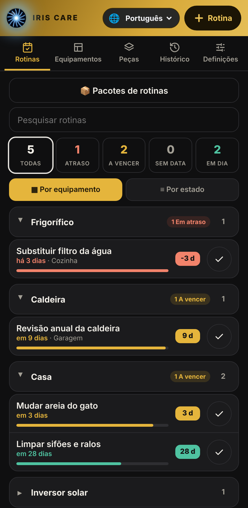
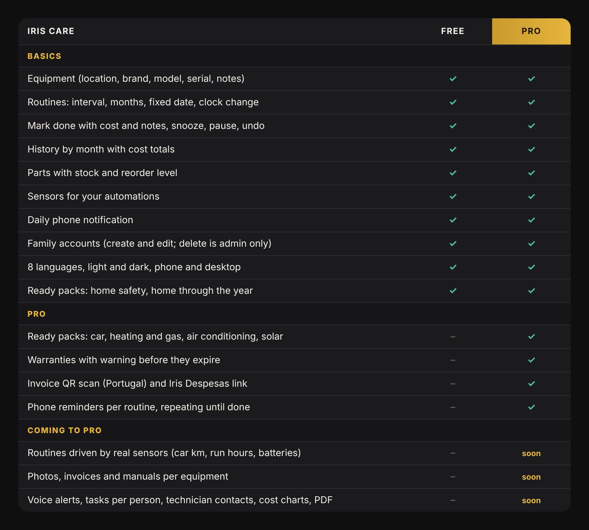
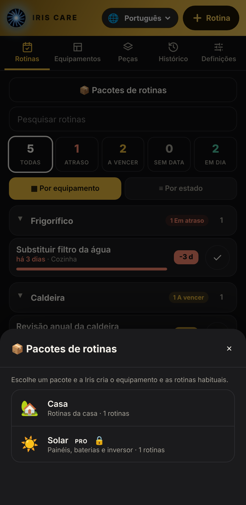

# Iris Care

**Gestor de manutenção da casa para o Home Assistant.** Equipamentos, rotinas, peças, histórico e um cartão para o dashboard que mostra de relance o que está em atraso, o que vence em breve e o que está em dia.

🇬🇧 [English version](README.md)

<p align="center"></p>

Feito pela [Eletro Solar Basto](https://github.com/Hollywoodchaos). A Iris Care é **gratuita e de código aberto**; a **Iris Care Pro** acrescenta pacotes e funções extra (ver [Free vs Pro](#free-vs-pro)).

---

## O que faz

Dizes à Iris Care o que tens (a caldeira, o carro, os detetores de fumo, o inversor solar) e o que há a fazer e de quanto em quanto tempo. Ela guarda as datas, avisa-te e lembra-se do que foi feito, quando e por quanto.

- Uma **barra fina** enche à medida que o prazo se aproxima e um **selo** mostra os dias (`-3 d` em atraso, `3 d` a vencer, `28 d` em dia), em vermelho, âmbar e verde.
- As rotinas ficam agrupadas por equipamento, com pesquisa e filtros.
- Toda a família pode usar com a sua própria conta.
- Cria sensores no Home Assistant, para fazeres as tuas automações.

## Instalação

### Com HACS (recomendado)

<a href="https://my.home-assistant.io/redirect/hacs_repository/?owner=Hollywoodchaos&repository=iris-care&category=integration" target="_blank"></a>

Ou procura **Iris Care** no HACS. Se ainda não aparecer: HACS → ⋮ → **Repositórios personalizados** → `https://github.com/Hollywoodchaos/iris-care`, categoria **Integração**.

1. Descarrega a **Iris Care** e reinicia o Home Assistant.
2. Definições → Dispositivos e serviços → **Adicionar integração** → **Iris Care**.
3. Adiciona o cartão a um dashboard: editar o dashboard → **Adicionar cartão** → **Iris Care**, ou em YAML:

```yaml
type: custom:iris-care-card
title: Care
```

### Manualmente
Copia `custom_components/iris_care` para `config/custom_components/`, reinicia e segue os passos 3 e 4.

> Vens da *Iris Manutenção* (o nome antigo)? Os teus dados são importados automaticamente na primeira vez que a Iris Care arranca.

## Começar em 5 minutos

1. Abre o cartão e toca em **📦 Pacotes de rotinas**. Escolhe **Segurança em casa** ou **Casa ao longo do ano** e adiciona as rotinas que quiseres. É a forma mais rápida de começar.
2. Vai a **Equipamentos** e acrescenta o que tens: caldeira, carro, frigorífico. Preenche só o que souberes.
3. Toca em **+ Rotina**, escolhe o equipamento e a agenda, e diz quando foi feita pela última vez.
4. Quando fizeres uma tarefa, toca no **✓**. Podes juntar o custo e uma nota. Tocaste sem querer? **Histórico → anular**.

## Os separadores

| Separador | Para que serve |
|---|---|
| **Rotinas** | Tudo o que há a fazer, por urgência. Filtra por em atraso, a vencer, sem data, em dia. Agrupa por equipamento ou por estado. |
| **Equipamentos** | As tuas coisas, com localização, categoria, marca, modelo, nº de série e notas. Toca num para ver as suas rotinas. |
| **Peças** | Filtros, lâmpadas, sal, pilhas… com stock e ponto de reposição. Ao dar uma rotina como feita podes indicar as peças usadas e o stock desce. |
| **Histórico** | Tudo o que fizeste, por mês, com o custo e o total mensal. Cada entrada pode ser anulada. |
| **Definições** *(admin)* | Quantos dias antes do prazo uma rotina passa a "a vencer" e o aviso diário no telemóvel. |

## Agendas

- **Intervalo**: de N em N dias, semanas, meses ou anos (por exemplo "de 6 em 6 meses").
- **Meses**: meses fixos do ano (por exemplo abril e outubro).
- **Data fixa**: uma data concreta, uma vez ou todos os anos (por exemplo a inspeção do carro).
- **Mudança de hora**: último domingo de março e de outubro na Europa. Ideal para as pilhas dos detetores de fumo.

Cada rotina pode também ser **adiada** (esconde-a uns dias) ou **pausada**.

## Contas da família

O administrador vê tudo. Os outros utilizadores (por exemplo a família) podem **criar e editar** rotinas, equipamentos e peças e dar tarefas como feitas, mas **não podem apagar** nada e não veem as **Definições** nem os **Pacotes**. Ninguém apaga uma rotina por engano. As alterações aparecem logo em todos os ecrãs.

## Avisos

Em **Definições → Dispositivos e serviços → Iris Care → Configurar** escolhe o(s) telemóvel(eis) e a hora do **aviso diário**. Lista o que está em atraso e o que vence em breve. A Pro acrescenta [avisos por rotina](#free-vs-pro) que se repetem até a tarefa estar feita.

## Sensores e automações

| Sensor | Valor |
|---|---|
| Em atraso, A vencer, Em dia | número de rotinas |
| Peças a repor | número de peças |
| Próxima tarefa | dias até à próxima rotina |
| Um sensor por rotina | dias até ao prazo (negativo = em atraso) |

Os nomes das entidades seguem o idioma do teu Home Assistant (por exemplo `sensor.iris_care_em_atraso`). Exemplo: agir quando há algo em atraso.

```yaml
trigger:
  - platform: numeric_state
    entity_id: sensor.iris_care_em_atraso
    above: 0
```

Cada vez que dás uma rotina como feita é lançado o evento `iris_care_completed`.

## Ações (Ferramentas de programador → Ações)

`add_equipment`, `add_part`, `add_routine`, `complete`, `undo`, `snooze`, `set_paused`, `adjust_stock`.

Formatos de agenda:
- `{type: interval, every: 6, unit: months}` (days, weeks, months, years)
- `{type: months, months: [4, 10]}`
- `{type: date, date: "2027-04-15", repeat: yearly}` (ou `once`)
- `{type: clock_change, which: [spring, autumn]}`

## Free vs Pro

<p align="center"></p>

A edição Free é completa e pronta a usar. A **Iris Care Pro** acrescenta os pacotes prontos do carro, aquecimento e gás, ar condicionado e **painéis solares e baterias** (feito por um instalador solar), garantias com aviso antecipado, leitura do QR da fatura com ligação ao Iris Despesas e avisos no telemóvel por rotina.

<p align="center"></p>

<p align="center">
  <a href="https://ko-fi.com/s/b061a23005"></a>
</p>

Um só pagamento, licença de uso pessoal, atualizações incluídas. A Pro instala-se exatamente como a Free, na mesma pasta: substitui `custom_components/iris_care` e reinicia.

## Idiomas

Português, English, Español, Français, Deutsch, Italiano, Русский, 中文. O cartão segue o idioma do teu Home Assistant e tem também o seu seletor.

## Problemas comuns

- **"Custom element doesn't exist" / erro de configuração no cartão**: faz **Ctrl+F5** para limpar a cache do navegador. Na app do telemóvel: Definições → App Companion → Depuração → *Repor cache do frontend*.
- **O cartão não mostra dados**: confirma que a integração *Iris Care* está instalada (Definições → Dispositivos e serviços).
- **Um familiar não vê as Definições nem os Pacotes**: é de propósito, só os administradores os têm.

## Créditos e origem

A ideia de partida veio do **Elmer**, de Phil Ecker ([philecker/elmer-ha](https://github.com/philecker/elmer-ha), licença MIT), um gestor de tarefas de manutenção para o Home Assistant. A Iris Care é um projeto à parte, escrito de raiz, com código próprio. O que é nosso:

- o cartão com barra e selo de dias, agrupamento por equipamento, pesquisa e filtros
- equipamentos com localização, marca, modelo e nº de série, peças com stock e histórico com anular
- agendas por meses, datas fixas e mudança de hora da Europa
- pacotes de rotinas prontos, incluindo o solar
- avisos no telemóvel e permissões por conta com atualização em direto
- oito idiomas

Obrigado, Phil Ecker, pela inspiração.

## Marcas

"Iris", "Iris Care" e o logótipo do olho Iris são marcas da Eletro Solar Basto. A licença cobre apenas o código-fonte; não dá direito a usar estes nomes nem o logótipo nos teus próprios produtos ou serviços.

## Licença

Edição Free: MIT, ver [LICENSE](LICENSE). Edição Pro: licença de uso pessoal, incluída na compra.
